# Chart gallery

Twenty-six reusable chart recipes for survey and behavioural analysis: what moves a metric and which attributes
matter, how rule-based segments split, what a segment does over time, where people flow, where sessions are lost. One small library on top of
[Apache ECharts 5](https://echarts.apache.org/) — no framework, no build step.

Open `index.html` to see every chart rendered with synthetic demo data and a code snippet.

> All numbers in this repository are synthetic. The demos are set in three invented settings: a travel booking site,
> a survey of hotel guests and a language-learning app.

## Charts

| Chart | Function | Use it when |
|---|---|---|
| State timeline | `ChartKit.stateTimeline` | you need to show what a segment *means*: where its members are at every time mark |
| State stack | `ChartKit.stateStack` | you need where everyone is at each moment, and any single state on demand: click a layer to isolate it |
| Sequence index | `ChartKit.sequenceIndex` | the individual paths behind an aggregate must be visible: one thin strip per session, colour = state |
| Segment tree | `ChartKit.segmentTree` | segments are defined by rules; each condition is written once, on its own split |
| Diverging bars | `ChartKit.divergingBars` | you open a topic with "what moves the metric up and down" |
| Grouped bars | `ChartKit.groupedBars` | two or three numbers per category must be compared — side by side, one scale |
| Flow sankey | `ChartKit.flowSankey` | three groupings have to be connected; nodes are clickable |
| Segment map | `ChartKit.segmentMap` | every segment goes on one picture: size against outcome, labels never overlap |
| Ladder | `ChartKit.ladder` | you need the spine of a report: "of 100 who started, N reached each step" |
| Heat table | `ChartKit.heatTable` | segments are described by variables; only real differences are shaded |

| Penalty–reward map | `ChartKit.penaltyRewardMap` | use it to show what an attribute does to a choice from both sides: x = penalty (how much a badly delivered attribute pushes people away, in percentage points), y = reward (how much a well delivered one pulls them in) |
| Contribution waterfall | `ChartKit.contributionWaterfall` | use it to explain a gap: how a group gets from a reference value (the average hotel) to its own value, one horizontal step per factor |
| Bar with dots | `ChartKit.barWithDots` | one number per item has to be shown together with its stability: the bar is the effect on the full base (blue raises the outcome, orange lowers it; one colour when the measure is unsigned), the dots are the same measure in each wave, light to dark |
| Rank bump | `ChartKit.rankBump` | use it to show whether the order of items holds from wave to wave: y = rank (1 on top), one line per item across the waves |
| Dumbbell | `ChartKit.dumbbell` | every row has two values of the same measure to compare — before and after, in the first search and in the last, users and non-users |
| Forest plot | `ChartKit.forestPlot` | use it to show what a model says each factor does on its own, holding the rest constant: one row per coefficient, a point at the estimate and a whisker for the 95% interval, sorted so the largest effect is on top |
| Clustered heatmap | `ChartKit.clusteredHeatmap` | use it to see which groups resemble each other in a profile of many variables — hotel types by the attributes their guests value, segments by the behaviours they show |
| Network graph | `ChartKit.networkGraph` | use it to show a fitted network of binary behaviours — a bayesian network, a path model — in the "tetrad + gephi" style: every node is a behaviour, its size is the share of people who show it (6 + 34·sqrt(share / max)), its colour is the community found by a greedy modularity pass (or passed per node), and the label reads "name n%" |
| Risk map | `ChartKit.riskMap` | use it to rank the things that go wrong on the way to an outcome: x = how common the event is (share of sessions, log scale), y = how often people leave without the outcome right after it |
| Event density | `ChartKit.eventDensity` | use it to show when things happen after a key moment (a booking, a sign-up, a first visit): one smoothed curve per channel on a log time axis with readable ticks (30 s, 1 min,  |
| State butterfly | `ChartKit.stateButterfly` | the "gone" mass matters as much as the active one: a 100% stacked area over time mirrored around zero — states that mean left or paused grow upwards, active screens sit below the line, the y axis runs 0–100 both ways |
| Segmentation panel | `ChartKit.segmentationPanel` | use it as the first table after a segmentation: one row per segment with its name, a share-of-base bar, the outcome bar with its value and a sparkline of the state timeline — a tiny 100% stacked column per time mark, colour = state |
| Session anatomy | `ChartKit.sessionAnatomy` | use it to show one session as a story: a shared time axis (linear or log; pauses longer than `pauseafter` are hatched and shortened), lanes = screens as coloured segments with a tick at every transition, a row of selection actions — what was added to a shortlist or a trip (numbered dot = new item, small dot = one more of an item, red cross = removed), a query row (diamond at the query start, red when nothing was found, a bar while the results stayed on screen), small diamonds where a card was opened, dashed highlight window, event pins and an optional step-line value track (balance, trip total) on top |
| Transition graph | `ChartKit.transitionGraph` | use it to show where people go from each screen |
| Semantic map | `ChartKit.semanticMap` | use it to explore a 2-d embedding (t-sne, umap) of texts or items: every point is one unit, coloured when it belongs to one of the top groups, grey when it belongs to another group, a ring when it has no group |
| Coverage chart | `ChartKit.coverageChart` | use it to show how far a set of items (tags, rules, features) reaches into the base and where adding more stops paying: one column per item in greedy order, grey = already covered by the items before it, blue = newly covered by this one, "+n" on top, the y axis in percent of the base |

### State timeline

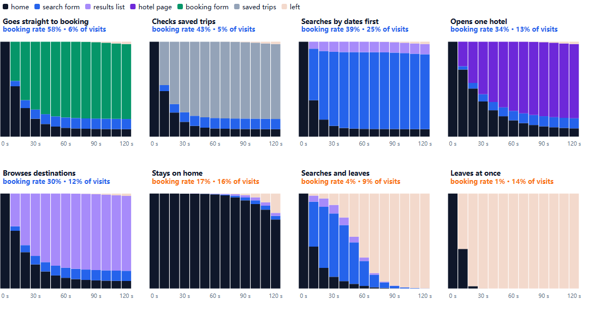

One small panel per segment, a 100% bar for every time mark, colour = state. If segments carry an outcome
(`value`), panels are sorted by it and the subtitle is coloured above or below the overall value.

### State stack

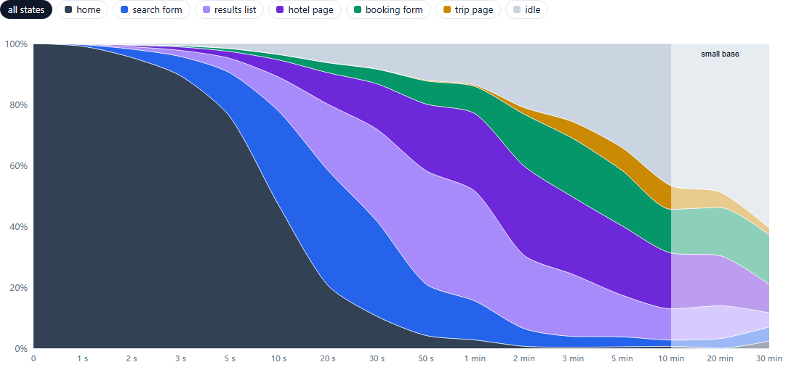

A 100% stacked area: one layer per state, the share of each state at every time mark (here — among the sessions
that are still going on). Thin layers are hard to read inside a stack, so a click on a layer or on its chip
isolates that state: it is redrawn alone from the baseline, on its own scale, with value labels. A click on the
chart or on the "all states" chip brings the stack back.

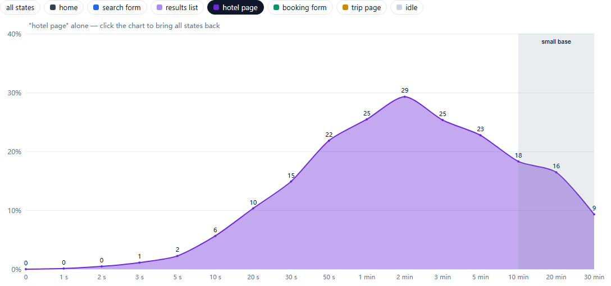

Pass `base` (how many units stand behind each mark) and `minBase` to dim the marks where the base is too small.
The function returns a controller: `isolate(state | null)`, `redraw(optsPatch)`, `dispose()`, `chart()`.

### Sequence index

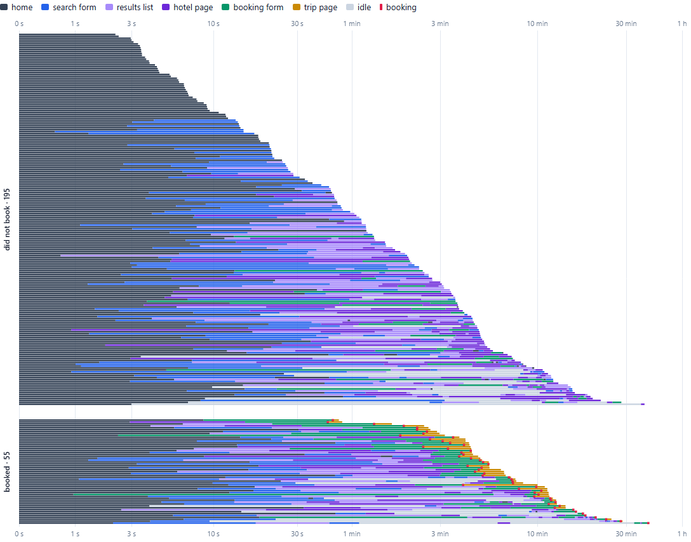

Every thin strip is one session from its start to its end; colour = the state at that moment. Strips are grouped
(here by outcome) and sorted by duration inside a group, and a red tick marks the key event. The time axis is
logarithmic (`log10(t + 1)`) or linear; `redraw({ scale: 'linear', maxTime: 600 })` switches it. Hovering a strip
shows its duration and the state under the cursor. Drawn on a plain canvas — no ECharts needed for this one —
and the container takes its height from the number of rows.

### Segment tree

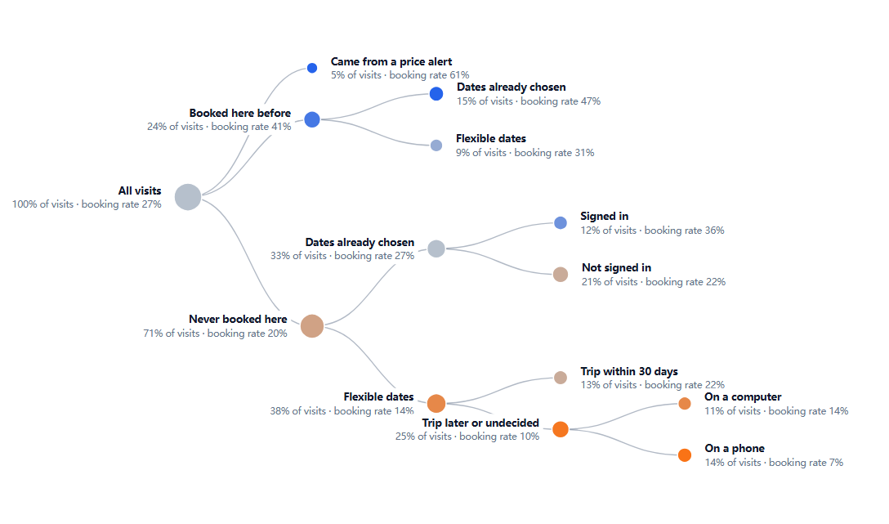

Node size = share of the base, colour = value above (blue) or below (orange) the overall value. Every node,
including the intermediate ones, shows its size and its value, so the reader sees what each split adds.

### Flow sankey

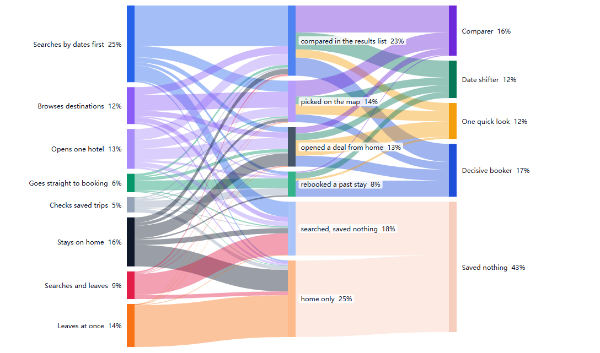

Nodes are reordered to reduce crossings (barycenter method). Similar nodes share a colour family across
columns. `onNodeClick` lets a node act as navigation.

### Segment map

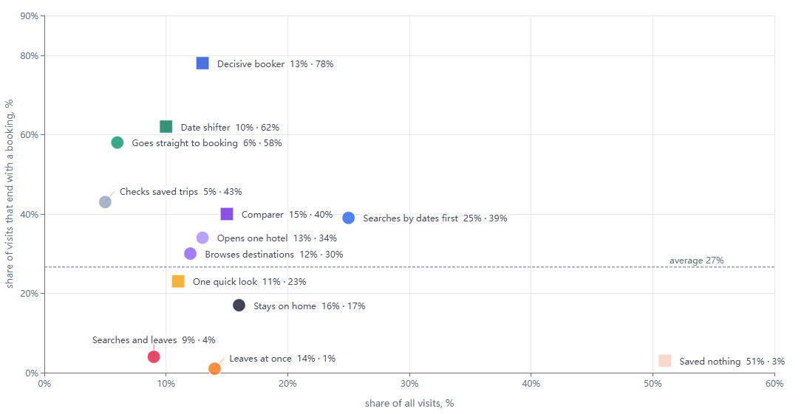

### Diverging bars · Grouped bars

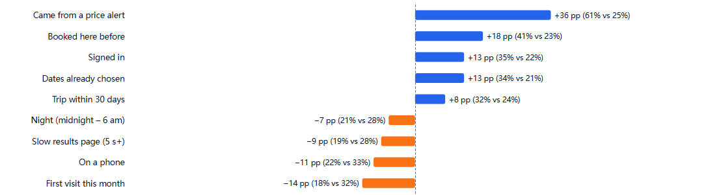

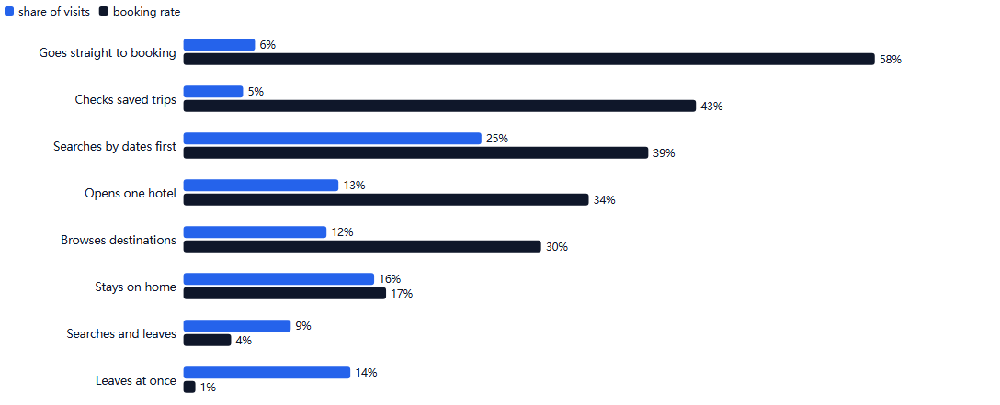

### Ladder · Heat table

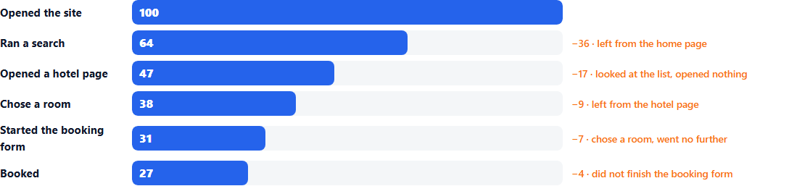

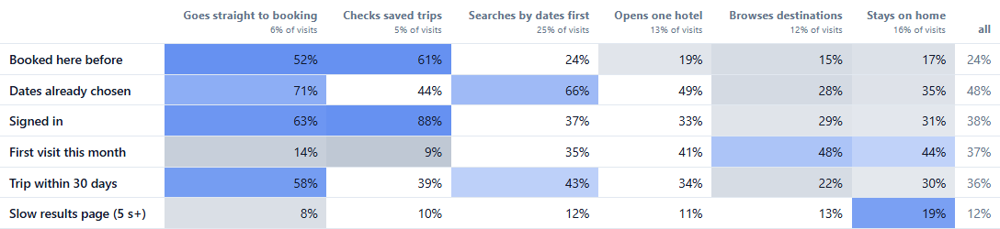

### Penalty–reward map

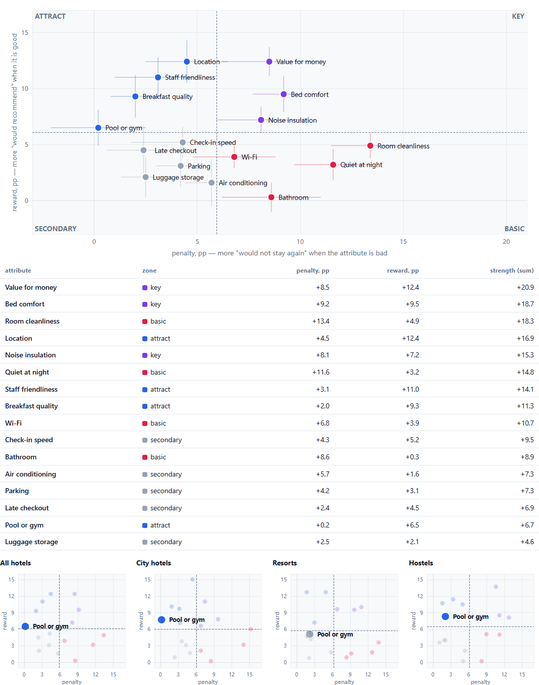

Use it to show what an attribute does to a choice from both sides: x = penalty (how much a badly delivered attribute pushes people away, in percentage points), y = reward (how much a well delivered one pulls them in). Dashed lines at the two means split four zones — attract (high reward, low penalty), key (both high), basic (high penalty, low reward), secondary — and the point colour is the zone. Tick the option to see the ± confidence crosshair behind each point; labels are moved apart automatically with leader lines; a zone table is rendered under the chart. Call the function several times with `highlight` and `compact` to get small multiples per group on a shared scale.

### Contribution waterfall

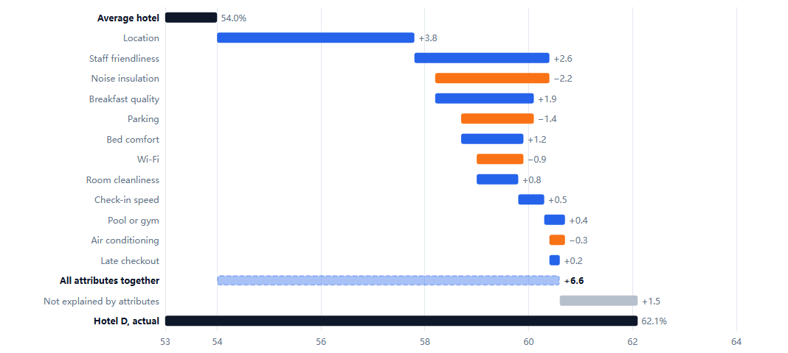

Use it to explain a gap: how a group gets from a reference value (the average hotel) to its own value, one horizontal step per factor. Steps are sorted by absolute size, blue raises the value and orange lowers it; a dashed bar sums all factors together and a grey bar holds the residual the factors do not explain. The start and end bars stand on zero, every step starts where the previous one ended (a transparent base stack). Hover a row for the value and its ± error.

### Bar with dots

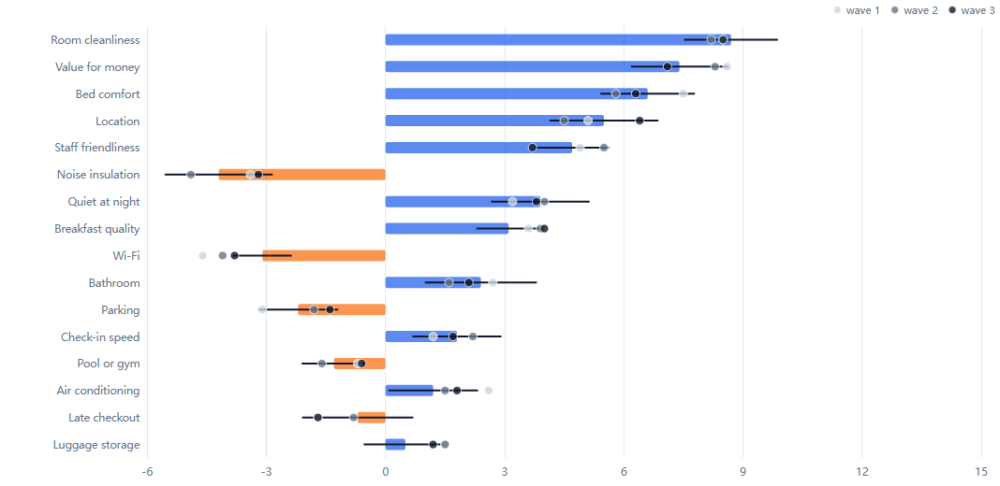

Use it when one number per item has to be shown together with its stability: the bar is the effect on the full base (blue raises the outcome, orange lowers it; one colour when the measure is unsigned), the dots are the same measure in each wave, light to dark. With `ci: true` a whisker shows the ± confidence interval across the bar; it is always in the tooltip. Items are sorted by absolute effect, largest on top.

### Rank bump

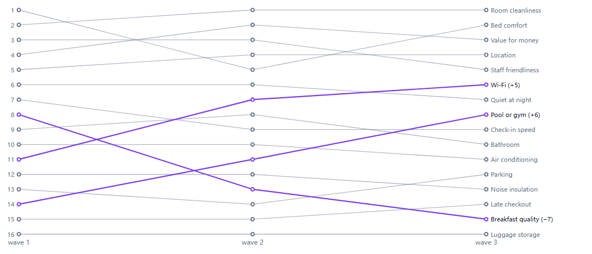

Use it to show whether the order of items holds from wave to wave: y = rank (1 on top), one line per item across the waves. Lines that moved by `minMove` places or more (default 5) between any two waves are coloured, the rest stay grey, so the eye goes to real movement; the end label carries the net change, e.g. 'Breakfast quality (−7)'. Hover a line to focus it and read every rank.

### Dumbbell

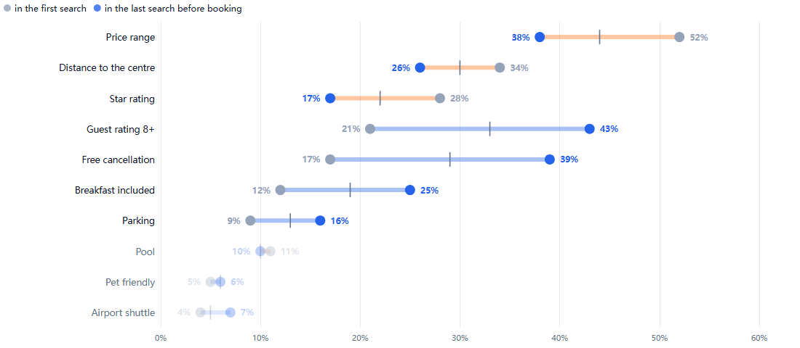

Use it when every row has two values of the same measure to compare — before and after, in the first search and in the last, users and non-users. The two dots are the values, the thick line between them is coloured by direction (blue when the second value is higher, orange when lower), the labels at both ends give the numbers, and a short vertical dash marks a base (the overall value) per row or for the whole chart. Rows where the difference is not significant are passed with dim: true and drawn faded. Hover a row for both values, the difference and the base.

### Forest plot

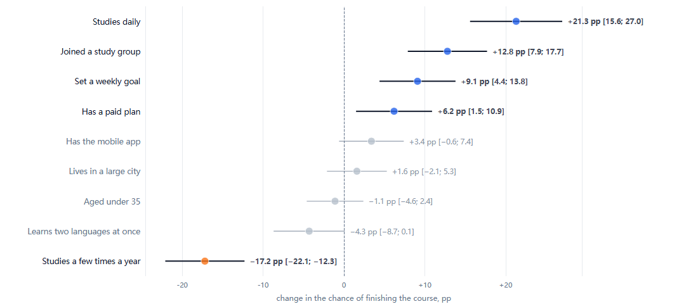

Use it to show what a model says each factor does on its own, holding the rest constant: one row per coefficient, a point at the estimate and a whisker for the 95% interval, sorted so the largest effect is on top. The reference line is 0 for differences in percentage points, or 1 for ratios (scale: 'ratio', multipliers on a log axis). Significant rows (p below alpha, or an interval that misses the reference) get a coloured point — blue above the reference, orange below — a dark whisker and a bold label such as "+3.2 pp [1.1; 5.3]"; the rest are grey. Hover a row for the numbers and the p-value.

### Clustered heatmap

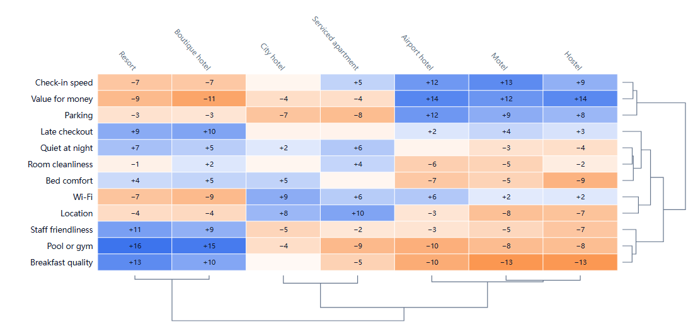

Use it to see which groups resemble each other in a profile of many variables — hotel types by the attributes their guests value, segments by the behaviours they show. Rows are variables, columns are groups; a cell is shaded by how far the group is from the overall value of that row (blue above, orange below, deeper = larger), or by the signed value itself when no overall is given. Rows and columns are reordered by Ward clustering and the dendrograms are drawn next to the map (rows to the right, columns below), so similar groups stand side by side. With orderBy: 'City hotel' the columns are instead sorted by their Euclidean distance to that column, the distance is written in the header and the column tree is omitted. Hover a cell for the value and the overall.

### Network graph

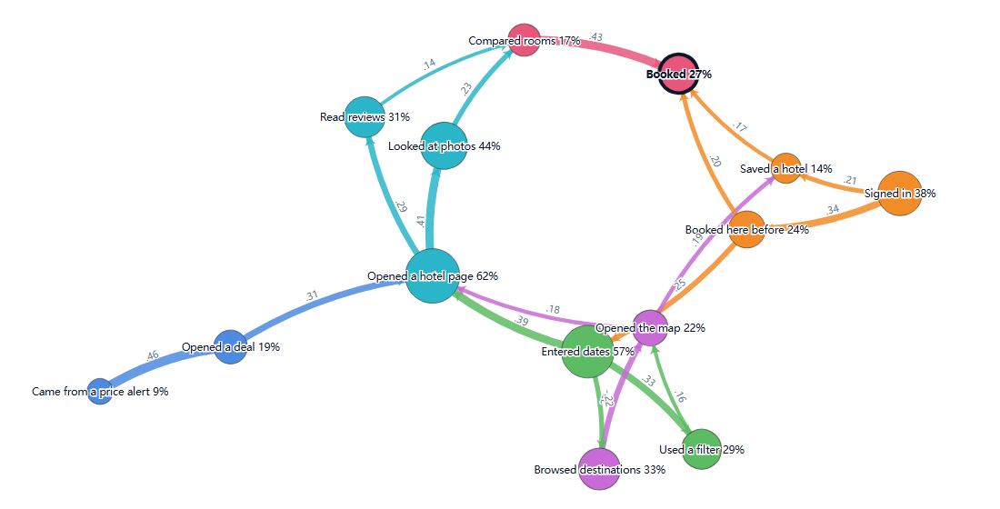

Use it to show a fitted network of binary behaviours — a Bayesian network, a path model — in the "Tetrad + Gephi" style: every node is a behaviour, its size is the share of people who show it (6 + 34·sqrt(share / max)), its colour is the community found by a greedy modularity pass (or passed per node), and the label reads "Name N%". Every edge is a model coefficient: width = 1 + 9·|coef| / max, colour = the source node at 85% opacity, curved with an arrow, labelled ".23". The default layout is a deterministic Fruchterman–Reingold force layout; with layout: 'columns' the nodes are placed in the columns given by node.column (a "path to the target" view), ordered inside each column by the barycentre of their predecessors, with captions above the columns, a ring on the target node and its incoming edges drawn in the text colour. Hover a node or an edge for the numbers; drag to pan, wheel to zoom.

### Risk map

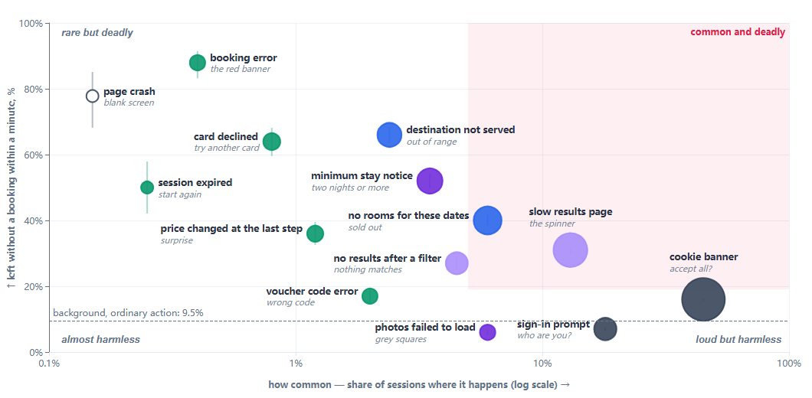

Use it to rank the things that go wrong on the way to an outcome: x = how common the event is (share of sessions, log scale), y = how often people leave without the outcome right after it. Bubble area = sessions lost that way, colour = stage, a hollow bubble = too few cases to trust, the whisker = 95% Wilson interval, the dashed line = the background rate after an ordinary action. Italic captions name the quadrants; the shaded zone is "common and at least twice the background". Hover a bubble for the counts.

### Event density

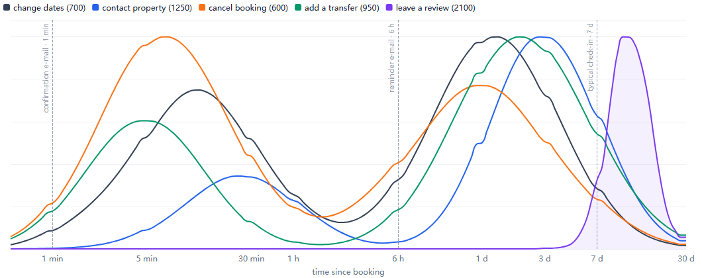

Use it to show when things happen after a key moment (a booking, a sign-up, a first visit): one smoothed curve per channel on a log time axis with readable ticks (30 s, 1 min, ... 24 h, or days when the ticks are passed in). Each curve is a kernel density of log time scaled to peak 1, so shapes are compared, not volumes; the tooltip gives the cumulative share of each channel by the moment under the cursor. Dashed verticals mark milestones such as "reminder e-mail". Pass raw times (the density is computed in the browser) or precomputed curves.

### State butterfly

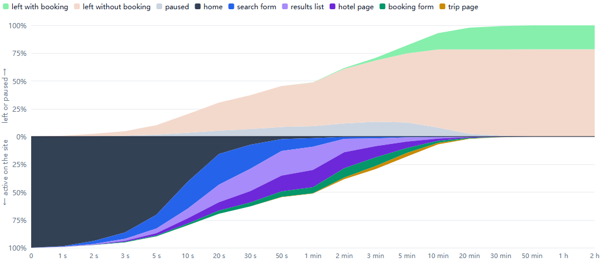

Use it when the "gone" mass matters as much as the active one: a 100% stacked area over time mirrored around zero — states that mean left or paused grow upwards, active screens sit below the line, the y axis runs 0–100 both ways. Time marks (log or linear) are passed in as labels. Click a legend item to toggle that state; hover for the exact shares at a mark.

### Segmentation panel

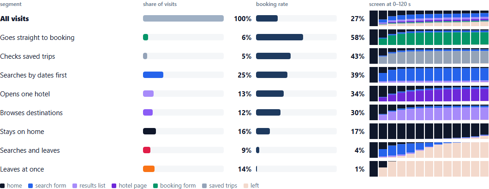

Use it as the first table after a segmentation: one row per segment with its name, a share-of-base bar, the outcome bar with its value and a sparkline of the state timeline — a tiny 100% stacked column per time mark, colour = state. Rows are sorted by the outcome, the overall row stays on top, so the eye reads "who is big, who converts, what they do" in one pass. Hover a sparkline column for the share of a state at that mark. Plain HTML, sizes itself; needs lib/parts/segmentation-panel.css.

### Session anatomy

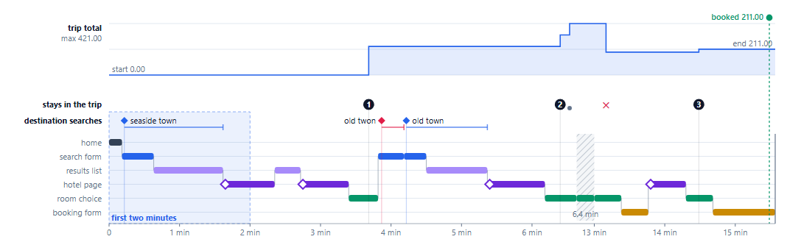

Use it to show one session as a story: a shared time axis (linear or log; pauses longer than `pauseAfter` are hatched and shortened), lanes = screens as coloured segments with a tick at every transition, a row of selection actions — what was added to a shortlist or a trip (numbered dot = new item, small dot = one more of an item, red cross = removed), a query row (diamond at the query start, red when nothing was found, a bar while the results stayed on screen), small diamonds where a card was opened, dashed highlight window, event pins and an optional step-line value track (balance, trip total) on top. Hover any mark for a native tooltip. Controls are the caller's job: `redraw({ scale: 'log' })`, `redraw({ compressPauses: false })`.

### Transition graph

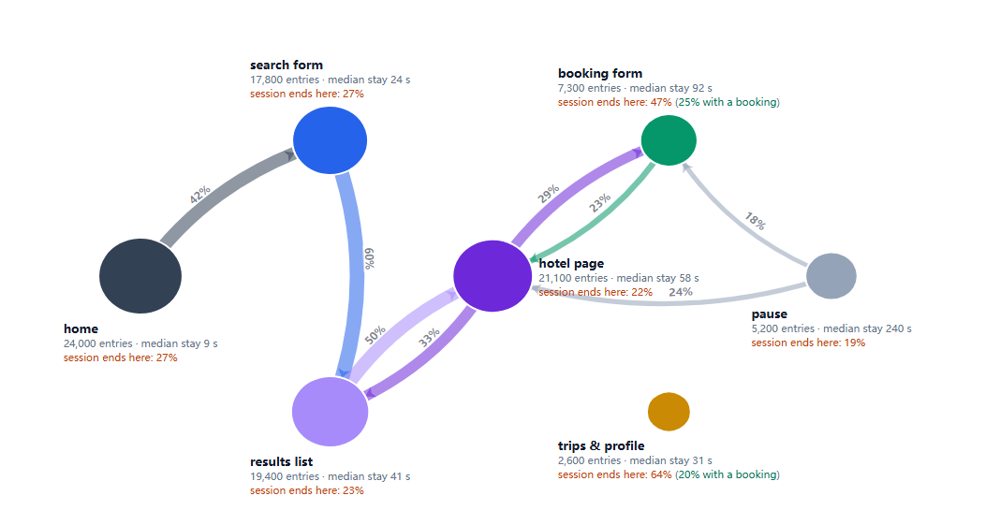

Use it to show where people go from each screen. Nodes sit where you put them (a fixed layout keeps the picture stable between groups), node size ~ square root of entries, the label gives entries, median dwell and the share of exits that end the session there; directed edges are coloured by source, width ~ square root of the count, labelled with the share of exits from the source, and hidden below `minShare`. Links to a target that is not a node count as terminal exits. `matrix: true` adds the full from → to table under the chart, shaded blue; with `links2` and `matrixMode: 'diff'` the table shows the difference between two groups in percentage points (blue = more in the first group, orange = less).

### Semantic map

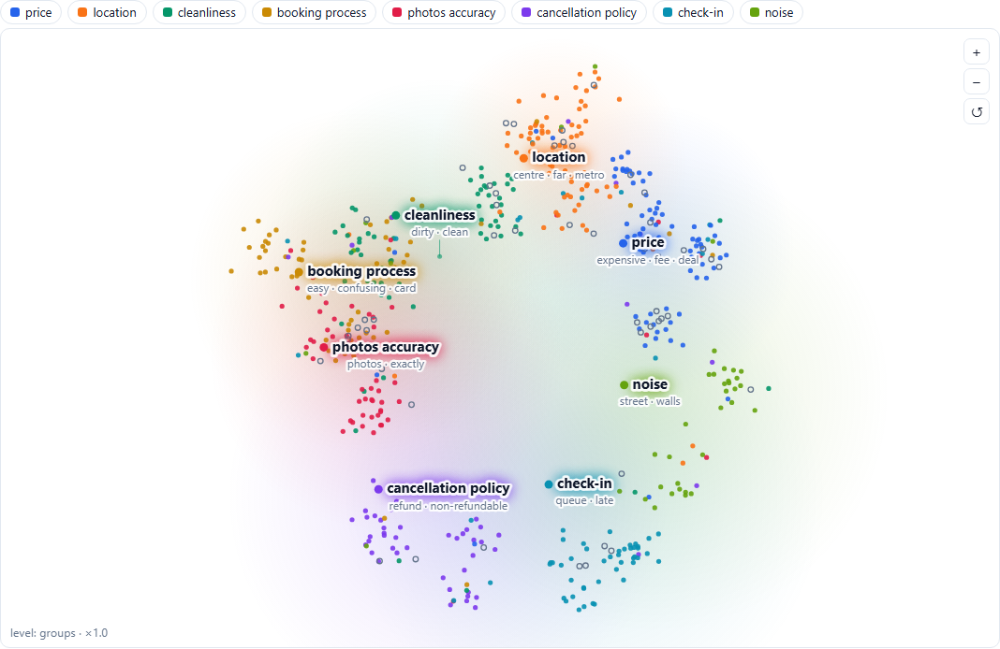

Use it to explore a 2-D embedding (t-SNE, UMAP) of texts or items: every point is one unit, coloured when it belongs to one of the top groups, grey when it belongs to another group, a ring when it has no group. A glow sits under the top groups. Zoom with the wheel after a click on the map (or with Ctrl), drag to pan, double click or use the + / − / reset buttons. Labels change with zoom: group names and their top words at low zoom, subgroups at mid zoom, small clusters at high zoom; label boxes avoid each other and point to their centroid with a leader line. Hover a point or a label for a tooltip; the group chips focus one group (hover = preview, click = pin). `onClick(point, label)` gets the point or the label that was clicked.

### Coverage chart

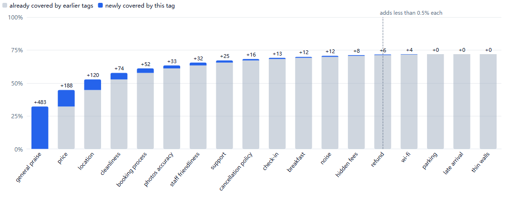

Use it to show how far a set of items (tags, rules, features) reaches into the base and where adding more stops paying: one column per item in greedy order, grey = already covered by the items before it, blue = newly covered by this one, "+N" on top, the y axis in percent of the base. Columns after the last item that adds at least `minGain` of the base sit behind a dashed line — that is the plateau. Pass precomputed `{ items, covered, added }` or raw `sets: { item: [ids] }` and let the greedy order be computed. `onClick(item)` fires on a column or its label.

## Quick start

```html
<script src="https://cdnjs.cloudflare.com/ajax/libs/echarts/5.5.0/echarts.min.js"></script>
<link rel="stylesheet" href="lib/charts.css">
<script src="lib/charts.js"></script>

<div id="tree" style="height: 600px"></div>
<script>
  ChartKit.segmentTree('tree', {
    tree: { name: 'All visits', share: 100, value: 27, children: [
      { name: 'Booked here before', share: 24, value: 41 },
      { name: 'Never booked here', share: 76, value: 23 } ] },
    base: 27, valueLabel: 'booking rate', shareLabel: 'of visits'
  });
</script>
```

Every chart needs a container with an explicit height (except the HTML and canvas ones — `ladder`, `heatTable`,
`sequenceIndex` — which size themselves). Shares and values are percentages on a 0–100 scale.
The option objects are documented above each function in `lib/charts.js`.

Colours follow CSS variables (`--ck-text`, `--ck-muted`, `--ck-line`, `--ck-bg`, `--ck-accent`), so the charts
pick up a light or dark theme from the page.

## Review page and Claude skill

- `review.html` — the same gallery in Russian with **like / dislike / rework** buttons under every chart. Verdicts
  and comments are kept in the browser; the bottom bar copies them as one text, downloads a JSON, or opens a
  prefilled GitHub issue.
- `skills/chart-gallery/SKILL.md` — a skill for Claude Code: which chart answers which question, minimal data
  shapes for every function, the presentation rules, a hand-over checklist. Copy the folder into
  `.claude/skills/` of a project (or `~/.claude/skills/`) and Claude draws these charts on request.
- `docs/claude-setup.ru.md` — step-by-step setup in Russian: how to get the files and connect the skill to Claude.
- `docs/PORTING_BRIEF.md` — the brief for adding a new chart as a part (`lib/parts`, `examples/parts`, `docs/parts`, `test/`);
  `tools/merge_parts.py` merges new parts into the library and the galleries, `tools/build_dist.py` rebuilds `dist/`.
- `dist/chart-gallery-single.html` — the gallery as one offline file with ECharts inlined.

## Python helpers

- `python/tree_segments.py` — fits a small decision tree on the 0/1 variables that drive a metric and returns
  the nested structure for `segmentTree`, a table of final segments with 95% intervals, and an out-of-fold
  check that the rules hold on rows they were not fitted on. Supports splitting off a rare but strong factor first.
- `python/flow_order.py` — turns a row-level table with three categorical columns into `columns` and `links`
  for `flowSankey`, already ordered to reduce crossings.

Both need `pandas`, `numpy` and (for the tree) `scikit-learn`.

## Presentation notes

A few rules these recipes were built around:

- If two numbers must be compared, put them side by side on one scale — not in separate panels.
- Write each condition once. Long labels that repeat the same prefix mean the chart should be a tree.
- Show the variables a segmentation is *built on* before the variables that merely describe it.
- Sort segments by the outcome and print the outcome next to the segment name.
- Shade only differences that are large enough to matter.
- Give sizes with every share, and say what the denominator is.

## Layout

```
index.html              gallery: every chart with demo data and a snippet
review.html             the gallery in Russian with feedback buttons
skills/chart-gallery/   SKILL.md for Claude Code
docs/claude-setup.ru.md setup instructions in Russian
dist/                   single-file offline gallery + echarts.min.js
lib/charts.js           the library (window.ChartKit)
lib/charts.css          theme variables; ladder, heat table, chip, legend and tooltip styles
examples/demo-data.js   synthetic demo data generators
python/                 data-preparation helpers
docs/img/               screenshots used in this README
docs/parts/, lib/parts/, examples/parts/, test/   one spec, source, demo and test page per ported chart
tools/                  merge_parts.py, build_dist.py
LICENSE                 MIT
```

## License

MIT — see [LICENSE](LICENSE). Copyright (c) 2026 Yury Wolfson.
